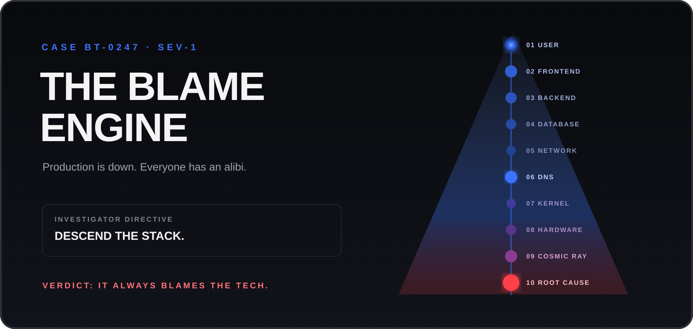
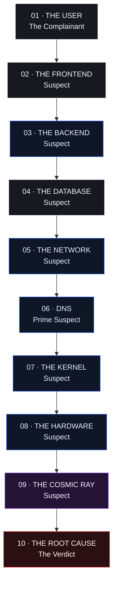
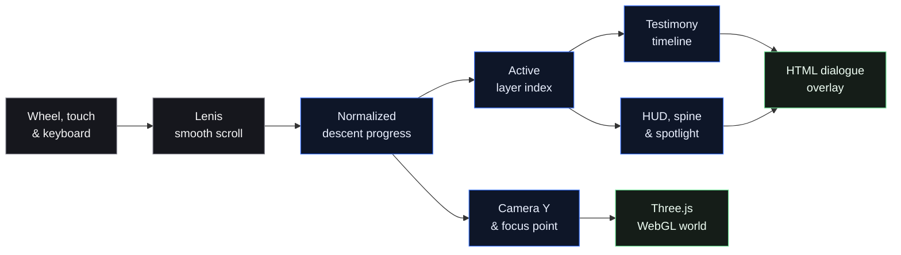
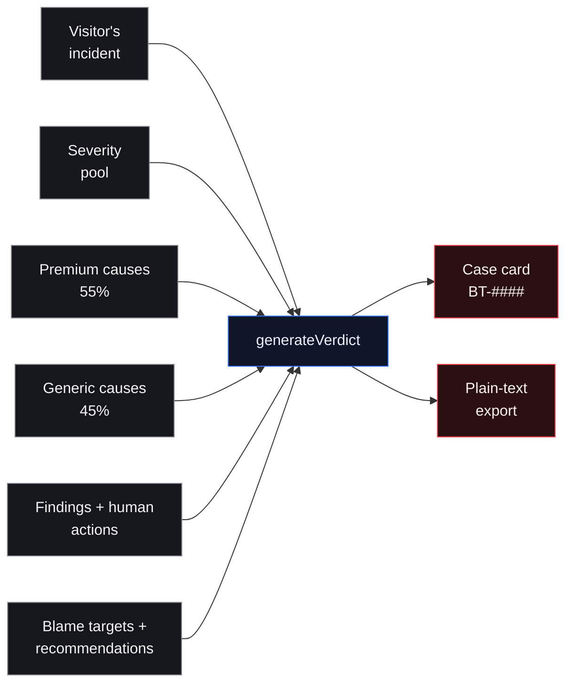
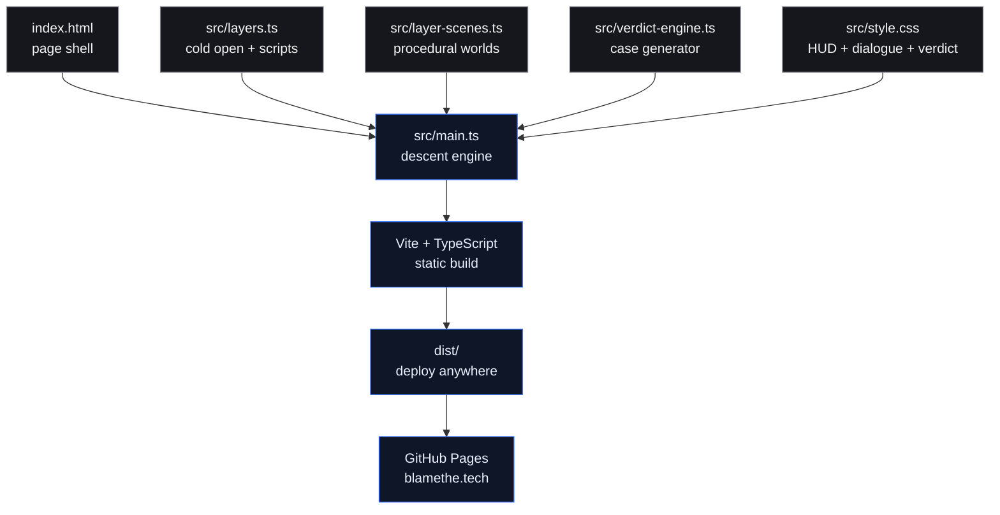

<p align="center">
  
</p>

<p align="center">
  <strong>Production is down. Everyone has an alibi. Descend the stack.</strong>
</p>

<p align="center">
  <a href="https://blamethe.tech"><strong>Open the investigation</strong></a>
  ·
  <a href="#the-descent">Review the suspects</a>
</p>

# The Blame Engine

At 02:47 in the morning, production goes down and forty thousand people are
staring at an error screen. You enter as the investigator and scroll downward
through ten layers of the stack. Every suspect gives testimony. Every suspect
points one layer lower.

At the bottom, the engine returns its verdict.

**It always blames the tech.**

## The descent

The experience is a continuous, scroll-driven WebGL interrogation. Each layer
has its own procedural Three.js environment, responsible party, role, script,
and animated character. The dialogue panel follows that character in screen
space while the camera travels deeper into the stack.



The writing is the engine's spine. The user changed nothing. The frontend made
art. The backend is merely a pipe. The database has metrics. The network keeps
receipts. DNS has heard this accusation before. The kernel followed orders.
The hardware only experiences events. The cosmic ray, refreshingly, admits
everything.

## How the world moves

Scroll position is converted into camera depth. That depth selects the active
interrogation, reveals its script one line at a time, updates the stack HUD, and
keeps the spotlight centered on the current speaker. Lenis smooths input;
Three.js owns the scene; ordinary HTML and CSS carry the readable interface.



The WebGL layer is enhancement, not the only way out: unsupported renderers
receive a fallback, the narrative remains in the DOM, and the interface
includes a light/dark theme switch plus reduced-motion rules.

## Ten procedural scenes

`src/layer-scenes.ts` contains one builder per suspect. Builders receive a
shared material context, add their own geometry to a layer group, identify the
object that speaks, and optionally return an animation callback.

```mermaid
flowchart TB
    M[Shared materials<br/>base · dark · accent · entity] --> B[Layer builder]
    B --> G[Procedural<br/>geometry group]
    B --> C[Character<br/>anchor]
    B --> U[Optional<br/>update(t)]
    G --> S[Three.js scene]
    C --> A[Dialogue panel<br/>screen position]
    U --> R[Render loop]
    R --> S

    classDef contract fill:#16171d,stroke:#858590,color:#f4f4f5
    classDef scene fill:#0e1628,stroke:#3b74ff,color:#eaf0ff
    classDef ui fill:#151d18,stroke:#63d98b,color:#effff4
    class M,B contract
    class G,C,U,S,R scene
    class A ui
```

The worlds are not downloaded models. They are assembled at runtime from
boxes, cylinders, spheres, rings, lines, particles, and emissive materials:

- a screaming monitor and anxious user;
- a browser window surrounded by floating controls;
- an API node with pipes and moving packets;
- a rotating database with table grids;
- a network mesh carrying packets;
- a switchboard drowning in DNS cables;
- the kernel, hardware, cosmic event, and final machine below.

## The verdict engine

The final card is generated entirely in the browser. It preserves the incident
the visitor entered, then combines a severity, root cause, finding, blame
target, recommendation, case number, and confidence score. Curated root causes
appear 55% of the time; human-action findings appear 35% of the time; confidence
is always a deeply reassuring 94–99%.



No request leaves the browser and no backend is involved.

## Repository map



The stack is intentionally compact: strict TypeScript, Vite, Three.js, Lenis,
and no application backend.

## Develop

```bash
bun install
bun run dev      # http://localhost:5173
bun run build    # TypeScript check + optimized static dist/
bun run preview  # preview the production build
```

Controls are simple: dismiss the cold open, then scroll to descend. Each station
dims the surrounding world, brings its suspect into the spotlight, and reveals
the testimony before inviting you lower.

## Deploy

The project builds as static assets for [blamethe.tech](https://blamethe.tech).
`public/CNAME` carries the custom domain. A GitHub Pages publishing workflow is
the remaining deployment wiring; the optimized output itself is produced by
`bun run build`.

Part of the [nixfred.com](https://nixfred.com) family.
